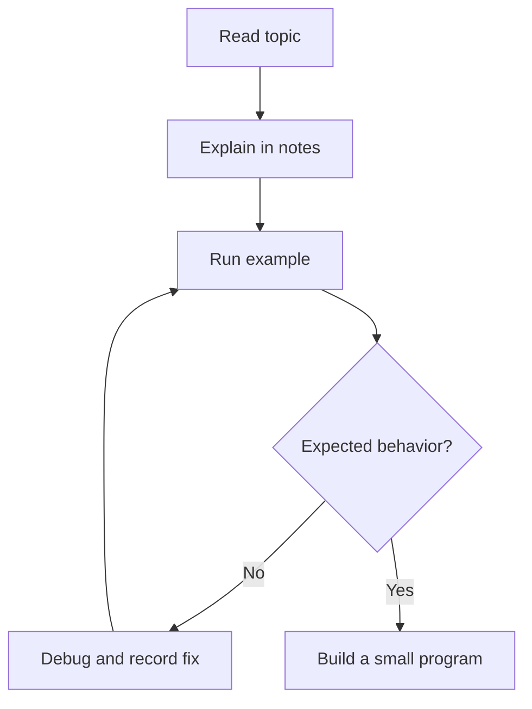

# Search, Links, and Diagrams — Practical Basics

## Find your notes quickly
- Search `for loop` to find matching content.
- Search `file:loops` to narrow by filename.
- Search `path:"03 - Data Structures"` to narrow a subject.
- Search `content:"common errors"` to find text.
- Search `"pointer arithmetic"` for the exact phrase.

Use the **Search** pane from Obsidian's sidebar; desktop shortcut is commonly `Ctrl+Shift+F` on Windows/Linux.

## Navigate within a long section note
- Use `##` topic headings and `###` fields. The **Outline** core plugin can display headings.
- A link can target a heading: `[[Name of Note#Topic Heading]]`.
- Link between notes only if it saves time. The shared quick-reference is optional, not a mandatory second copy.

## Helpful beginner techniques
- Wrap a short code term in single backticks, like `for`.
- Use fenced code blocks for snippets with language indicators (e.g. `cpp`, `python`, `go`, `asm`, `sql`).
- Store original diagrams intended for public sharing in `90 - Assets/00 - PUBLIC - ORIGINAL DIAGRAMS`.
- Store private textbook photos/screenshots and restricted assets in `90 - Assets/99 - PRIVATE - LOCAL ONLY`, which is ignored by Git.
- If you create a Canvas, ensure any screenshots or embeds it uses are safe for a public repository before publishing.

## Example: a quick flowchart with built-in Mermaid support

Mermaid is text-based, so simple diagrams are easy to version with Git. Use Canvas when dragging and arranging visual material would genuinely help.
